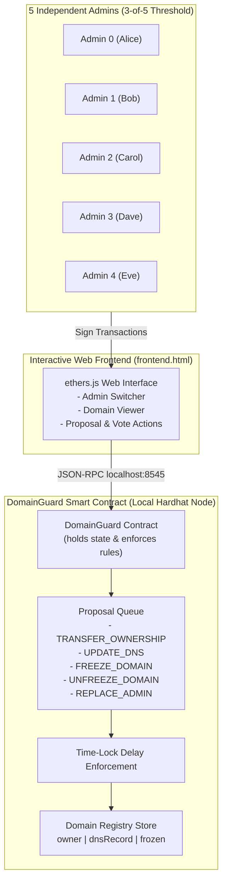

# 🔐 DomainGuard — Multi-Party Authorization Domain Registry

> **Hackathon:** BLOCKHACK 2026  
> **Problem Statement:** PS-08 ("The Rogue Admin")  
> **Solution:** Decentralized M-of-N Multi-Sig Domain Registry with Emergency Freeze & Time-Lock Protection.

---

## 📌 Problem Overview

In a traditional domain registrar or enterprise setup, employees or administrators hold database or API credentials. If an admin goes rogue, is bribed, or has their credentials leaked, they can unilaterally transfer high-value domains (e.g., `google.com`, `bank.com`, or critical DNS records) to an attacker. Traditional role-based access control (RBAC) and database logging cannot stop this attack in real time.

**DomainGuard** solves this at the protocol level:
1. **The smart contract itself holds domain ownership and DNS state.** It is not an afterthought audit log.
2. **No single admin can ever act alone.** Any critical operation requires approval from **3 out of 5** independent admins.
3. **Time-Lock Window:** Non-emergency operations enforce a mandatory delay (e.g., 60 seconds in demo; 48 hours in production) after reaching threshold approvals before execution. If rogue activity is spotted, honest admins can cancel the proposal.
4. **Emergency Freeze:** In active attacks, any **2 out of 5** admins can immediately freeze a domain with zero time-lock, halting all transfers and DNS changes.
5. **Lost-Key Recovery:** If an admin key is lost or compromised, **3 other admins** can swap it for a new key via `REPLACE_ADMIN`. The replaced admin is prohibited from voting on their own replacement.
6. **No Owner Backdoor:** There is no `owner`, no `onlyOwner` modifier, no proxy upgrade backdoor, and no superuser override.

---

## 🏗️ Architecture



---

## 📂 Project Structure

├── contracts/
│   └── DomainGuard.sol        # Core smart contract (Solidity 0.8.24)
├── test/
│   └── DomainGuard.test.js    # Comprehensive Chai test suite (all 8+ scenarios)
├── scripts/
│   ├── demo.js                # Narrative console demo script (Acts 1, 2, 3)
│   ├── deploy.js              # Deployment script for local node & frontend
│   ├── generate-admins.js     # Creates 5 throwaway test admin wallets
│   └── deploy-sepolia.js      # Deployment script for Sepolia Public Testnet
├── frontend.html              # Local Hardhat frontend with ethers.js
├── frontend-sepolia.html      # Public Sepolia testnet frontend with MetaMask
├── admins.json                # 5 Admin public addresses (safe to commit)
├── .env.example               # Environment template for Sepolia RPC & Deployer key
├── .gitignore                 # Protects .env and admins.private.json
├── hardhat.config.js          # Hardhat configuration (local + Sepolia)
├── README.md                  # Project overview & instructions
├── EXPLAIN.md                 # Simple explanations for judges & team
└── DEFENSE.md                 # Defense against critical questions
```

---

## 🚀 Quick Start Guide

### 1. Prerequisites
- Node.js (v18+ or v20+)
- npm

### 2. Run All Automated Tests
To run the automated test suite testing normal flows, attack attempts, time-locks, and edge cases:
```bash
npx hardhat test
```

### 3. Run the Narrative Demo Script
To see the complete 3-Act live demonstration in your console:
```bash
npx hardhat run scripts/demo.js
```

### 4. Run the Web Frontend

1. **Start the local Hardhat blockchain node** in a terminal:
   ```bash
   npx hardhat node
   ```
2. **Deploy the contract** in another terminal:
   ```bash
   npx hardhat run scripts/deploy.js --network localhost
   ```
3. Copy the printed contract address.
4. Open `frontend.html` in your web browser (double click or open via Chrome/Firefox).
5. Paste the contract address into the input box and click **Connect**.
6. You can switch between Alice, Bob, Carol, Dave, and Eve using the admin buttons, submit proposals, vote, freeze domains, and see real-time updates!

---

## 🛡️ Tested Scenarios

| Scenario | Expected Outcome | Status |
|---|---|:---:|
| 1. Normal Transfer | 3 approvals + time-lock passes → Domain ownership updates | ✅ Passed |
| 2. Attack: Rogue Solo Execution | 1 approval → `execute()` reverts: `"not enough approvals"` | ✅ Passed |
| 3. Attack: Double Approval | Admin votes twice → reverts: `"admin already approved"` | ✅ Passed |
| 4. Attack: Early Execution | Executing before time-lock expires → reverts: `"time-lock period not yet over"` | ✅ Passed |
| 5. Attack: Non-Admin Action | Outsider proposes or approves → reverts: `"caller is not an admin"` | ✅ Passed |
| 6. Emergency Freeze | 2 approvals freeze domain instantly; subsequent transfers blocked | ✅ Passed |
| 7. Lost Key Recovery | 3 other admins replace lost key; old key revoked, new key active | ✅ Passed |
| 8. Disagreement & Stalling | Honest admins disagree (only 2 votes) → execution blocked; proposal cancellable | ✅ Passed |

---

## 🌐 Sepolia Public Testnet Deployment Guide

> **🌐 Live Web App (Firebase):** [https://domainguard-2k26.web.app](https://domainguard-2k26.web.app)  
> **Live Contract Address (Sepolia):** [`0xca7af44C99e90a4FF4E9f2839F603E18B1cB38D7`](https://sepolia.etherscan.io/address/0xca7af44C99e90a4FF4E9f2839F603E18B1cB38D7)  
> **Deployment Tx:** [`0x5a94f7b66a559b6faccd22c3c639bea6079ff6e35f76f0d0bb667c5be7e29475`](https://sepolia.etherscan.io/tx/0x5a94f7b66a559b6faccd22c3c639bea6079ff6e35f76f0d0bb667c5be7e29475)  
> **Network:** Ethereum Sepolia (Chain ID `11155111`)

Follow these exact steps to run **DomainGuard** on the public Ethereum Sepolia testnet:

### Step 1: Generate Throwaway Admin Wallets
Create 5 fresh test wallets locally:
```bash
node scripts/generate-admins.js
```
- Public addresses are saved to `admins.json` (safe to commit).
- Private keys are saved to `admins.private.json` (**STRICTLY GITIGNORED**).
- **Admin 0 (Alice)** is designated as your primary deployer.

### Step 2: Configure `.env`
Open your local `.env` file (which is gitignored) and add:
```env
SEPOLIA_RPC_URL=https://ethereum-sepolia-rpc.publicnode.com
DEPLOYER_PRIVATE_KEY=<privateKey_of_Admin_0_from_admins.private.json>
```

### Step 3: Get Free Sepolia Test ETH
Admin 0 needs approximately 0.01 Sepolia test ETH for deployment gas:
- **Google Cloud Web3 Faucet:** https://cloud.google.com/application/web3/faucet/ethereum/sepolia
- **Alchemy Sepolia Faucet:** https://www.alchemy.com/faucets/ethereum-sepolia
- **Sepolia PoW Faucet:** https://sepolia-faucet.pk910.de/

Paste Admin 0's public address (from `admins.json`) into the faucet.

### Step 4: Deploy to Sepolia
Once test ETH arrives in Admin 0's wallet, run:
```bash
npx hardhat run scripts/deploy-sepolia.js --network sepolia
```
The script will:
1. Verify that your wallet has enough Sepolia test ETH.
2. Deploy the contract registered with the 5 admin addresses from `admins.json`.
3. Print the contract address and Sepolia Etherscan transaction link.
4. Automatically save deployment details to `deployed-sepolia.json`.

### Step 5: Import Accounts into MetaMask
To interact with the multi-sig system from different admin perspectives:
1. Open MetaMask $\rightarrow$ Click the Account dropdown $\rightarrow$ **Add account or hardware wallet** $\rightarrow$ **Import account**.
2. Copy the private key for Admin 0 from `admins.private.json` and paste it. Label it "Admin 0 - Alice".
3. Repeat for Admin 1 (Bob), Admin 2 (Carol), etc.
4. Ensure MetaMask is switched to the **Sepolia** testnet.

### Step 6: Launch the Sepolia Web Frontend
1. Open [`frontend-sepolia.html`](frontend-sepolia.html) in your browser.
2. The page auto-detects `deployed-sepolia.json` or you can paste the contract address into the top bar.
3. Click **Connect MetaMask**.
4. Test the multi-sig workflow live on the public blockchain:
   - Propose a transfer or DNS update from Admin 0.
   - Switch accounts in MetaMask to Admin 1 and Admin 2 $\rightarrow$ click **Approve** on each.
   - Wait out the 120-second time-lock window.
   - Click **Execute** and view the verified transaction directly on [Sepolia Etherscan](https://sepolia.etherscan.io)!

---

## 🔧 Sepolia Troubleshooting Guide

| Issue | Cause | Solution |
|---|---|---|
| **"⚠️ Not on Sepolia network"** | MetaMask is connected to Ethereum Mainnet or a local node | Click the **Switch to Sepolia** button in the banner, or select "Sepolia" in MetaMask. |
| **"INSUFFICIENT SEPOLIA TEST ETH"** | The deployer address has 0 balance | Request free Sepolia test ETH from a faucet for Admin 0's address. |
| **"DomainGuard: caller is not an admin"** | The active MetaMask account is not one of the 5 addresses in `admins.json` | Switch to an imported admin account in MetaMask (e.g. Alice, Bob, or Carol). |
| **"DomainGuard: time-lock period not yet over"** | `execute()` was called before the 120-second delay finished | Wait for the 120-second timer to expire after the 3rd approval is mined on Sepolia. |
| **"Transaction rejected by user"** | You clicked "Reject" in the MetaMask popup | Click "Confirm" in MetaMask to sign and broadcast the transaction. |
| **"DomainGuard: domain is frozen"** | Domain has been locked by 2-of-5 emergency freeze | Propose and pass an `UNFREEZE_DOMAIN` proposal (needs 3 approvals + time-lock). |
