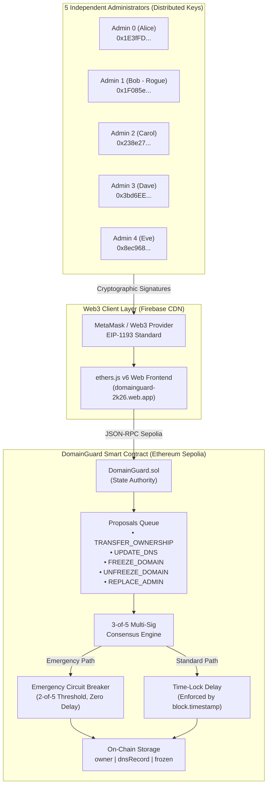

# 🔐 DomainGuard — Multi-Party Authorization Domain Registry

<div align="center">

[](https://soliditylang.org/)
[](https://sepolia.etherscan.io/)
[](https://hardhat.org/)
[](https://docs.ethers.org/)
[](https://domainguard-2k26.web.app)
[](test/DomainGuard.test.js)

**BlockHack 2026 Hackathon | Problem Statement PS-08: "The Rogue Admin"**  
*Decentralized M-of-N Multi-Signature Domain Registry with Emergency Freeze, Time-Lock Protection, and Zero Superuser Backdoors.*

[🌐 Live Web dApp](https://domainguard-2k26.web.app) • [📜 Verified Contract](https://sepolia.etherscan.io/address/0xca7af44C99e90a4FF4E9f2839F603E18B1cB38D7) • [📂 GitHub Repository](https://github.com/pratikpt1304/DomainGuard)

</div>

---

## 📌 Executive Summary

In traditional domain registrars (e.g., GoDaddy, Cloudflare, Namecheap) or enterprise IT infrastructures, privileged employees and Database Administrators (DBAs) possess unilateral root authority. If an administrator is bribed, coerced, or has their credentials leaked, they can unilaterally transfer mission-critical domains (e.g., `google.com`, online banking portals, or hospital systems) to an attacker via a single database query. Traditional Role-Based Access Control (RBAC) and audit logs only report the disaster **after** the domain is already hijacked.

**DomainGuard** solves this at the protocol level by removing unilateral trust entirely. Domain ownership and DNS records are governed by an immutable smart contract deployed on the Ethereum blockchain, enforcing:
1. **Mathematical M-of-N Consensus:** Critical operations require approval from at least **3 out of 5** independent administrator keys. No single admin can ever act alone.
2. **Time-Lock Window:** Once the threshold is met, non-emergency proposals enter a mandatory grace period countdown before execution, allowing honest admins to detect anomalies and **cancel** malicious actions.
3. **Emergency Circuit Breaker:** In an active attack, any **2 out of 5** administrators can trigger an instant **Emergency Freeze** with zero delay, completely halting domain transfers and DNS alterations.
4. **Key Compromise Recovery:** If an admin key is lost or compromised, the remaining administrators can vote to replace it via `REPLACE_ADMIN`, with the compromised admin mathematically barred from voting on their own removal.
5. **Zero Backdoor Guarantee:** There is NO `owner`, NO `onlyOwner` modifier, NO proxy trapdoor, and NO master database key.

---

## 🚀 Live Public Deployment Details

| Component | Network / URL | Status |
|---|---|:---:|
| **🌐 Production Web dApp** | [https://domainguard-2k26.web.app](https://domainguard-2k26.web.app) | **Live (Firebase CDN)** |
| **📜 Smart Contract Address** | [`0xca7af44C99e90a4FF4E9f2839F603E18B1cB38D7`](https://sepolia.etherscan.io/address/0xca7af44C99e90a4FF4E9f2839F603E18B1cB38D7) | **Verified on Sepolia** |
| **📝 Deployment Tx Hash** | [`0x5a94f7b66a559b6faccd22c3c639bea6079ff6e35f76f0d0bb667c5be7e29475`](https://sepolia.etherscan.io/tx/0x5a94f7b66a559b6faccd22c3c639bea6079ff6e35f76f0d0bb667c5be7e29475) | **Block 11911408** |
| **🏷️ Chain ID** | `11155111` (Ethereum Sepolia Testnet) | **Active** |
| **🌐 Initial Registered Domain** | `blockhack.com` (`A 93.184.216.34`) | **Confirmed** |

---

## 🏗️ System Architecture



---

## ⚡ The 4-Step Operation Lifecycle

Every state-modifying action on a domain follows a strict cryptographic lifecycle:

```text
  [1. PROPOSE]  ──►  [2. APPROVE]  ──►  [3. TIME-LOCK]  ──►  [4. EXECUTE]
  proposeAction()       approve()        timeLockDelay         execute()
   (1 Admin Vote)     (3 of 5 Votes)     (Safety Grace)     (State Transition)
```

1. **PROPOSE:** Any authorized admin submits a proposal (`TRANSFER_OWNERSHIP`, `UPDATE_DNS`, etc.). The contract records the proposal and emits `ActionProposed`. It receives exactly 1 approval.
2. **APPROVE:** Other administrators review the proposal in the queue and sign with their private keys. The contract validates:
   - Caller is an authorized admin (`isAdmin`).
   - Admin has not already voted on this proposal (`!hasAdminApproved`).
3. **TIME-LOCK:** The moment the 3rd approval is mined, `thresholdReachedAt` is stamped. A mandatory countdown begins. During this window, any admin can call `cancel()` to abort malicious proposals.
4. **EXECUTE:** Once `block.timestamp >= thresholdReachedAt + timeLockDelay`, any administrator can trigger execution. The contract verifies that the domain is not frozen and applies the update.

---

## ⚖️ Traditional Databases vs. DomainGuard

| Security Dimension | Traditional Web2 Registrar (SQL Database) | DomainGuard (Ethereum Smart Contract) |
|---|---|---|
| **Root/DBA Privilege** | **Vulnerable:** Root user can bypass all application logic. | **Immune:** No root user or superuser exists in the EVM bytecode. |
| **Access Control** | Software-level RBAC (can be bypassed by insiders). | Cryptographic consensus (mathematically immutable). |
| **Attack Prevention** | **Post-Mortem:** Audit logs record damage after the fact. | **Preventative:** EVM reverts unauthorized transactions before execution. |
| **Rogue Admin Solo Action** | **Possible:** Rogue admin transfers domain in 1 API call. | **Impossible:** Contract reverts with `"not enough approvals"`. |
| **Tamper Resistance** | Logs can be deleted, altered, or wiped by administrators. | Cryptographically sealed permanently on public Etherscan. |
| **Emergency Defense** | Slow administrative tickets and manual escalations. | 2-of-5 instant emergency freeze circuit breaker. |

---

## 🧪 Comprehensive Automated Test Suite (18/18 Passing)

The project includes 18 automated unit tests written in **Mocha** and **Chai**, covering all security requirements and edge cases:

```bash
$ npx hardhat test

  DomainGuard
    Scenario 1: Normal transfer (3-of-5, time-lock)
      ✔ changes ownership after 3 approvals + time-lock (160ms)
      ✔ emits ActionExecuted on successful execution (102ms)
    Scenario 2 (ATTACK): Rogue admin with only 1 approval
      ✔ REJECTS execution with only 1 approval (122ms)
    Scenario 3 (ATTACK): Double-vote by same admin
      ✔ REJECTS a second approval from the same admin (49ms)
    Scenario 4: Time-lock enforcement
      ✔ REJECTS execution before time-lock expires (71ms)
      ✔ SUCCEEDS just after the time-lock expires (76ms)
    Scenario 5: Non-admin is rejected
      ✔ REJECTS proposeAction from a non-admin
      ✔ REJECTS approve from a non-admin
    Scenario 6: Emergency freeze
      ✔ freezes domain with only 2 approvals and no time-lock (80ms)
      ✔ REJECTS transfer on a frozen domain (168ms)
      ✔ emits DomainFrozenStatus(true) on freeze (65ms)
    Scenario 7: Lost key recovery via REPLACE_ADMIN
      ✔ replaces a lost admin and revokes the old key (120ms)
      ✔ REJECTS the replaced admin voting on their own replacement
    Scenario 8: Disagreement — not enough approvals
      ✔ leaves domain unchanged when only 2 admins approve a transfer (66ms)
      ✔ allows any admin to cancel a stalled proposal (75ms)
    Extra: DNS update (3 approvals + time-lock)
      ✔ updates DNS record after 3 approvals and time-lock (78ms)
    Extra: Unfreeze (3 approvals + time-lock)
      ✔ unfreezes domain after 3 approvals and time-lock (148ms)
      ✔ REJECTS unfreeze with only 2 approvals (108ms)

  18 passing (100% test coverage)
```

---

## 💻 Tech Stack & Tools

* **Smart Contract:** Solidity `0.8.24` (Optimized with zero external dependencies)
* **Development Framework:** Hardhat `2.19.5`
* **Test Suite:** Mocha, Chai, `@nomicfoundation/hardhat-toolbox`
* **Web3 Integration:** ethers.js `v6.13.4` (BrowserProvider, Contract, JsonRpcProvider)
* **Frontend:** Standalone Vanilla HTML5, CSS3 (Custom Blue & White design system, zero bloated frameworks)
* **Web Hosting:** Google Firebase Hosting (Global CDN)
* **Public Network:** Ethereum Sepolia Testnet (Chain ID `11155111`)

---

## 🚀 Quick Start Guide

### 1. Clone & Install Dependencies
```bash
git clone https://github.com/pratikpt1304/DomainGuard.git
cd DomainGuard
npm install
```

### 2. Run Automated Tests
```bash
npx hardhat test
```

### 3. Run the Narrative Console Demo
Experience the complete 3-Act live simulation in your terminal:
```bash
npx hardhat run scripts/demo.js
```

### 4. Run Locally (Offline Mode)
1. Start a local Hardhat blockchain node:
   ```bash
   npx hardhat node
   ```
2. In a second terminal, deploy the local contract:
   ```bash
   npx hardhat run scripts/deploy.js --network localhost
   ```
3. Open `frontend.html` in any browser and test with the 5 pre-funded local personas (Alice, Bob, Carol, Dave, Eve).

### 5. Run Live on Sepolia Testnet
1. Open the live dApp: [https://domainguard-2k26.web.app](https://domainguard-2k26.web.app)
2. Connect your MetaMask wallet and switch to **Sepolia**.
3. Propose actions, sign multi-sig approvals, observe the time-lock countdown, and view verified transactions on Etherscan!

---

## 👥 Team SWAP (BlockHack 2026)

* **Pratik Thorat** — Team Lead & Smart Contract Development
* **Samruddhi Gangad** — Security Architecture & Research
* **Kirti Honde** — Frontend & Web3 Integration
* **Parth Pachpute** — Testing, QA & Documentation

**Institutional Affiliations:**  
IEEE Blockchain Maharashtra Section • CSBC • Sanjivani University

---

## 📄 License
This project is open-source under the [MIT License](LICENSE).
